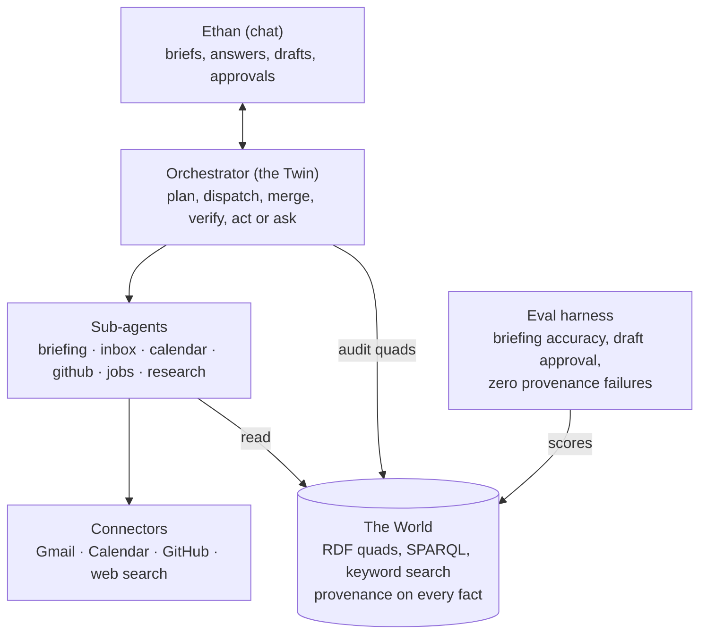
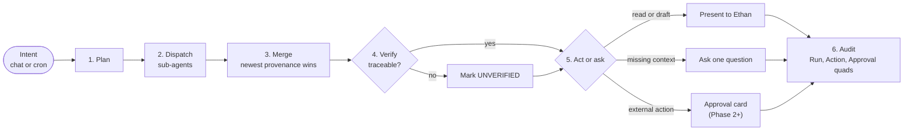
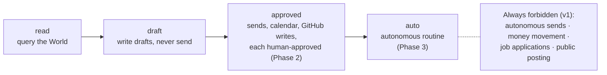

# Wazoo Twins — Ethan Davidson Twin (v1)

A Twin is a **super-agent that orchestrates many other agents using shared,
expansive context via Worlds infrastructure**. This repo holds the first Twin:
Ethan Davidson's personal twin, a dogfood build. The World is the memory; the
Twin is the agent that acts on it.

**Owner:** [@EthanThatOneKid](https://github.com/EthanThatOneKid) · **License:**
MIT · **Set up, check, and test:** `deno task ci`

## Status

Phase 0 + Phase 1 implemented (Nov 6, 2026). Read-only Twin: briefings,
research, drafts — no external writes. Phase 2 (supervised writes) is not built
yet.

Design docs: `docs/ethan-davidson-twin-scope.md` (what a Twin is) and
`docs/ethan-davidson-twin-implementation-plan.md` (how it is built).

## How it fits together

Ethan talks only to the orchestrator. Sub-agents are scoped tools that never
talk to Ethan or to each other; the World holds every fact and every audit
record; the eval harness scores the whole system against the World.



## What it does (v1)

- **Morning brief** (7:30am PT) and **evening summary** (6pm PT) from the World
  — every line cited to its source.
- **On-demand answers** from the World with citations; anything untraceable is
  marked UNVERIFIED, never asserted.
- **Inbox triage + draft replies** (drafts only, never sent).
- **Calendar, GitHub, and job-pipeline watch** (read-only).
- **Research briefs** for upcoming calls (public sources first).

### The orchestrator loop

Every request, chat or scheduled, runs the same bounded loop (max 3 rounds, 10
tool calls). Nothing leaves the loop unverified, and every run is written back
to the World as audit quads.



## Stack

TypeScript + Deno. `@worlds/sdk` (`memory` in-memory backend for dev/tests,
`@worlds/libsql` durable local backend, `worlds-api` hosted switch). Custom
orchestrator loop. Model is pluggable (DeepSeek default, frontier switch);
without a model key, draft prose falls back to deterministic templates. Runs on
this VM; scheduled by cron.

## Quickstart

```sh
deno task ci      # format check, lint, typecheck, and tests
deno task seed    # build the World from MEMORY.md, trackers, GitHub
deno task smoke   # 20 smoke questions, answered with citations
deno task eval    # held-out eval set + baseline scores
deno task brief --kind morning   # dry-run morning brief (stdout only)
```

See `docs/runbook.md` for environment variables, cron jobs, and recovery.

## Guardrails (non-negotiable)

- Provenance on every quad (`source` + `retrievedAt`); Worlds has no native
  provenance column yet (worlds-sdk-ts#221) — the Twin carries it itself.
- Verifier gate: untraceable claims are marked UNVERIFIED, never asserted.
- No external action without approval. Phase 1 is read-only: no sends, no GitHub
  writes, no calendar creates.
- Seed data lives outside the repo (see `docs/runbook.md`).
- Hosted search is keyword-only (worlds-api#1); vector search is local-only.

### Permission tiers

A sub-agent can never raise its own tier. Phase 1 runs at `read` and `draft`
only; `auto` is Phase 3. Money movement, job applications, and public posting
are forbidden at every tier.


